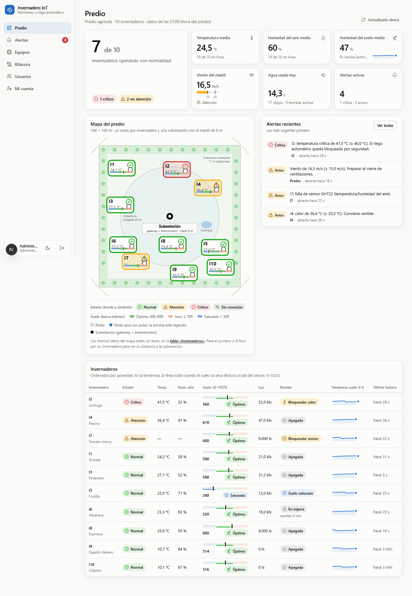
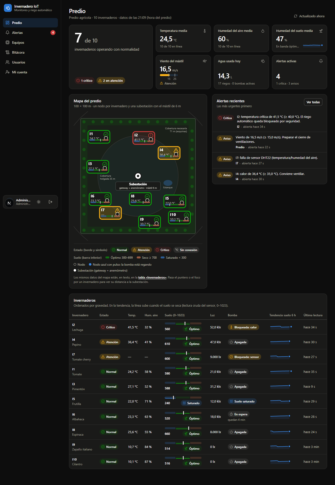
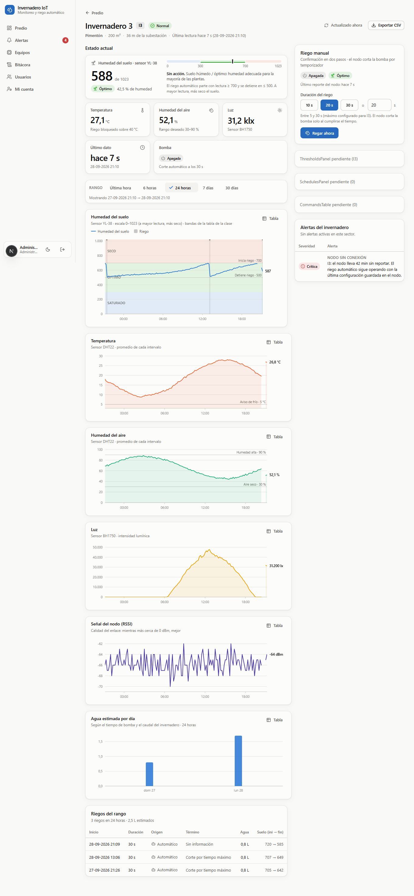
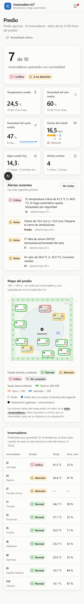

# Invernadero IoT · monitoreo y riego automático de invernaderos

Implementación funcional del informe **«Diseño de una solución IoT para el monitoreo y riego automático de invernaderos»**
(INACAP · Seguridad IoT · alternativa 2, bajo costo). Incluye el **firmware del nodo ESP32**, una **base de datos en Supabase**
y un **dashboard web en TypeScript** con control de acceso por rol.

## Capturas

| Predio (claro) | Predio (oscuro) |
|---|---|
|  |  |

| Detalle de un invernadero | Móvil |
|---|---|
|  |  |

<sub>Capturas de referencia tomadas durante el desarrollo, con datos **simulados**; la interfaz puede diferir en detalles menores.</sub>

## Qué incluye

| Carpeta | Qué es |
|---|---|
| `firmware/nodo_invernadero_unico/` | **El firmware para ESP8266 (NodeMCU, D1 mini) en UN solo archivo `.ino`**, para Arduino IDE y sin depender de otros archivos: DHT22 + YL-38 + bomba por relé, lógica de riego autónoma y cliente HTTP. Es el que se carga en la placa. |
| `firmware/nodo_invernadero_unico_esp32/` | El mismo firmware de un solo archivo para **ESP32** (DevKit V1 o Heltec V2). |
| `firmware/nodo_invernadero/` | La versión modular de ESP32 (la fuente de la lógica compartida, con pruebas de host). Guía completa en [`docs/hardware.md`](docs/hardware.md). |
| `dashboard/` | Aplicación web **Next.js 16 + React 19 + TypeScript estricto**: API de recepción de los nodos, paneles por rol, gráficos, alertas, órdenes de riego, bitácora. |
| `supabase/migrations/` | Esquema SQL (PostgreSQL 17): tablas, permisos mínimos, bitácora inmutable. |
| `docs/` | [`contrato-api.md`](docs/contrato-api.md) (protocolo nodo ↔ servidor), [`hardware.md`](docs/hardware.md), [`seguridad.md`](docs/seguridad.md) (controles del informe → código). |

**¿Por qué TypeScript?** Es el lenguaje con mejor relación entre productividad, seguridad de tipos y ecosistema para un panel web:
los mismos tipos viajan del acceso a datos a la interfaz, y el compilador (modo `strict`) detecta errores antes de ejecutar. El
firmware queda en C++ (Arduino) porque el ESP32 lo exige.

## Arquitectura

```
 ┌────────────────┐   HTTPS · JSON · Bearer   ┌─────────────────────────┐   SQL sobre TLS verificado   ┌────────────────────┐
 │ Nodo ESP32 ×N  │ ────────────────────────▶ │  Dashboard (Next.js)    │ ───────────────────────────▶ │ Supabase Postgres  │
 │ DHT22 · YL-38  │ ◀──── cfg + órdenes ───── │  /api/ingest · páginas  │   rol iot_app (mín. priv.)   │ esquema privado iot│
 │ relé → bomba   │                           │  sesiones · RBAC · CSP  │                              │ RLS + bitácora     │
 └────────────────┘                           └─────────────────────────┘                              └────────────────────┘
        ▲  (o el simulador: `npm run demo`)               ▲
        └── riega solo aunque no haya red                 └── navegador: dueño · admin · agrónomo · operador · técnico
```

Las cuatro capas del informe se conservan: **percepción y acción** (nodos), **red** (HTTP en lugar de LoRaWAN, ver más abajo),
**procesamiento** (API + reglas + alertas) y **aplicación** (dashboard). El riego **no depende del servidor**: cada nodo decide con su
propia lectura y aplica límites duros (corte a 30 s, espera de 5 min, bloqueo por temperatura); el servidor solo ajusta umbrales y
envía órdenes manuales.

## Puesta en marcha

Requisitos: **Node.js ≥ 22.12** y el archivo `env.txt` de Supabase (ya está junto a esta carpeta).

```bash
npm install          # instala las dependencias de dashboard/
npm run setup        # crea .env.local, migra la base y siembra el predio de ejemplo (10 invernaderos), usuarios demo y nodos (sin datos simulados)
npm run dev          # http://localhost:3000   (también sirve `npm start`)
```

Estos comandos se pueden ejecutar **desde esta carpeta o desde `dashboard/`**: los de la raíz delegan en `dashboard/` (`npm start` en la raíz
levanta el servidor de desarrollo; la versión de producción es `npm run build` y luego `npm run start:prod`).

* **Cuentas demo** (una por rol, con contraseña aleatoria): `dashboard/.demo-credentials.md`.
* **Datos en vivo sin hardware**: en otra terminal, `npm run demo` (simula los nodos sembrados y el mástil, con un guion de alertas).
  Variantes: `npm run simulate -- --speed 120`, `--scenario heat|fault|offline|wind|dry|irrigate`, `--only I1,I3`, y
  `--add I11=<token>` para simular un invernadero creado desde el panel.
  `npm run demo` usa `--fast`: fija «Reporte del nodo» en 15 s para ver alertas en minutos y lo **restaura a 300 s al salir con Ctrl+C**
  (si cierras la terminal a la fuerza, vuelve a dejarlo en 300 s desde el panel de umbrales de cada invernadero).
* **Con una placa real (Arduino IDE)**: `npm run dev:lan`, abre `firmware/nodo_invernadero_unico/nodo_invernadero_unico.ino` (ESP8266; para ESP32,
  `nodo_invernadero_unico_esp32`) y completa su bloque
  «CONFIGURACION DEL USUARIO»: WiFi, la URL `http://<IP-de-tu-PC>:3000` y el token del nodo. El token de un invernadero **nuevo** se muestra una
  sola vez al crearlo en *Invernaderos → Nuevo invernadero*; los de ejemplo están en `dashboard/.demo-devices.json` (ver [`docs/hardware.md`](docs/hardware.md)).

Hasta que un nodo reporte por primera vez, el panel muestra «Sin datos»; si un nodo deja de reportar, pasa a «Sin conexión» a los 15 min.
**El simulador escribe en la MISMA base que los nodos reales**: no lo uses junto con ESP32 reales. Si lo usaste, limpia con
`npm run db:reset-data -- --yes` (borra telemetría, riegos, órdenes y alertas; conserva usuarios, invernaderos, umbrales y nodos con sus tokens).

## Roles y permisos

Implementados en `dashboard/src/lib/rbac.ts` (matriz de la tabla 11 del informe) y verificados en cada página, acción y consulta.

| Rol | Puede |
|---|---|
| Dueño | Ver el predio, alertas e historial de **todos** los sectores; exportar CSV. Solo lectura. |
| Administrador | Todo: usuarios, **invernaderos (alta, edición y baja)**, ajustes del predio, tokens de nodos, umbrales, riego, bitácora. |
| Ingeniero agrónomo | Analizar historial, ajustar umbrales, programar calendarios de riego, reconocer alertas. |
| Operador de campo | Ver alertas y **accionar el riego solo en sus sectores asignados** (confirmación en 2 pasos). |
| Técnico | Solo lectura: calidad de enlace (RSSI/SNR), estado de equipos y bitácora. Nunca acciona actuadores. |

## La cantidad de invernaderos no es fija

Los 10 del informe son solo el predio de ejemplo. El administrador maneja los invernaderos desde **Invernaderos** (menú lateral):

* **Nuevo invernadero**: nombre, cultivo, superficie, caudal de la bomba y posición en el mapa (clic en el mapa o el botón «Sugerir un lugar
  libre», que propone el sitio libre más cercano a la subestación). En una sola operación se crean el invernadero, sus umbrales (por defecto
  o copiados de otro) y su **nodo con su token**, que se muestra una vez. El código (`I11`, o el que elijas) es único y no cambia.
* **Editar** los datos y la posición, **Ajustes del predio** (tamaño del mapa, subestación, estanque) para que el predio crezca con los invernaderos.
* **Dar de baja / Reactivar**: nada se borra. Un invernadero dado de baja conserva todo su historial, sale del panel y su nodo queda
  deshabilitado (el servidor rechaza sus tramas). El nodo físico sigue regando de forma autónoma hasta que se apague.
* Un invernadero nuevo no lo ve ningún operador hasta que se le asigne en **Usuarios**. No hay un máximo práctico (hasta 32.767).
* Todo queda en la bitácora (`greenhouse.create`, `.update`, `.archive`, `.restore` y `site.update`).

La migración es `supabase/migrations/0003_scalable_greenhouses.sql` (se aplica con `npm run db:migrate`).

## Cómo está integrado Supabase

* **La conexión directa del `env.txt` (`db.<ref>.supabase.co`) solo tiene IPv6**, y muchas redes (incluida la de esta máquina) no
  la alcanzan. Por eso `npm run setup` descubre el *pooler* IPv4 del proyecto (`aws-0-us-west-2.pooler.supabase.com:5432`) y
  conecta por ahí, con **TLS verificado** contra la CA de Supabase (incrustada en `src/lib/db/supabase-ca.ts`).
* **La aplicación no usa el rol `postgres`.** Usa `iot_app`, con permisos mínimos: sobre la bitácora solo puede `INSERT`/`SELECT`.
  La clave de `postgres` vive en `dashboard/.env.admin.local` y solo la leen los scripts de migración y semilla.
* **Todo está en el esquema privado `iot`**, que la API pública de Supabase no expone, con RLS activado y sin permisos para
  `anon`/`authenticated`. Para verlo en Supabase: *Table Editor → esquema `iot`*.
* La base **nunca se consulta desde el navegador**; solo el servidor (Server Components, acciones y la ruta `/api/ingest`).

## Seguridad (resumen)

Contraseñas con scrypt · bloqueo tras 5 fallos · sesiones en base con expiración por rol (administrador 30 min) · TOTP opcional y
exigible por rol (`MFA_REQUIRED_ROLES`) · cookies `HttpOnly` + `SameSite=Lax` · CSP con nonce · un token por nodo (solo se guarda su
SHA-256) con anti-repetición · validación de rangos · órdenes de riego con doble confirmación · **bitácora inmutable con hash
encadenado y verificación desde la interfaz**. El detalle, control por control del informe, está en [`docs/seguridad.md`](docs/seguridad.md).

## Pruebas

```bash
cd dashboard
npm test            # 160+ pruebas unitarias (controlador de riego, alertas, TOTP con vectores RFC 6238, scrypt, RBAC, escalas de gráficos…)
npm run test:db     # ~80 pruebas de integración contra TU Supabase (cada una se revierte). Tarda ~10 min; no las ejecutes con el simulador corriendo.
cd ../firmware/test && ./ejecutar_pruebas.sh     # lógica del nodo compilada en el PC (ver firmware/README.md)
```

## Decisiones y hallazgos sobre el informe

1. **Transporte**: el informe usa LoRaWAN → ChirpStack → MQTT → ThingsBoard. Aquí el último tramo es **HTTP(S) → API del dashboard →
   Supabase**, porque es lo que se puede probar con una placa y WiFi. El *payload* no cambia si se vuelve a LoRaWAN.
2. **Escala del YL-38**: se usa la de la imagen de la clase (**0–1023**: 0–300 saturado, 300–700 óptimo, 700–1023 seco). El ESP32
   mide en 12 bits (0–4095) y el firmware lo lleva a 10 bits. Riega con lectura ≥ 700 y se detiene en ≤ 500.
3. **Mini bomba** de la imagen (2,5–6 V, 80–120 L/h) en lugar de la bomba de 1/2 HP del informe, siempre con fuente propia y relé.
4. **Regla de «activaciones anómalas»** (tabla 10): con corte a 30 s y una sonda con retardo, casi todos los riegos terminan por
   tiempo máximo, así que «3 cortes seguidos» habría alertado siempre. La señal correcta es *tres riegos automáticos seguidos con
   menos de 15 min entre sí* (el suelo vuelve a secarse enseguida).
5. **Pines en placa Heltec V2**: el informe declara «probado en Heltec WiFi LoRa 32 V2», pero cinco de sus pines (GPIO 26, 4, 34, 25 y 21)
   chocan con el radio LoRa, la pantalla, el LED y `Vext` de esa placa; el firmware trae un mapa alternativo. Evidencia, tomada del
   archivo de pines del core de Espressif, en [`docs/hardware.md`](docs/hardware.md).
6. **Fuera de alcance del código** (son infraestructura): VLAN/cortafuegos MikroTik, VPN WireGuard, certificados de cliente X.509,
   elemento seguro ATECC608A y respaldo diario cifrado. Ver la sección correspondiente de `docs/seguridad.md`.

## Antes de producción

* Sirve el dashboard **detrás de HTTPS** y define `FORCE_HTTPS=true` (cookies `Secure`, HSTS). El firmware debe usar `https://`.
* Despliega **cerca de la base** (Oregón, `us-west-2`): cada consulta a Supabase cuesta ~200 ms desde Chile; una trama tarda ~1,2 s
  en régimen estable y hasta ~5 s tras un período inactivo. En serverless usa el pooler en modo transacción (`DATABASE_PORT=6543`).
* Activa el 2FA obligatorio: `MFA_REQUIRED_ROLES=admin,owner`.
* **Rota la contraseña de `postgres`** (está en `env.txt` y en `dashboard/.env.admin.local`) y borra el `env.txt` cuando termines.
  Cambia o desactiva las cuentas demo (`Usuarios → Desactivar`).
* Este repositorio incluye archivos con credenciales (`env.txt`, `dashboard/.env.local`, `dashboard/.env.admin.local`, `dashboard/.demo-*`):
  **mantenlo PRIVADO** y no lo publiques ni lo compartas fuera del equipo.
* Programa `npm run db:retention` (90 días de datos crudos, luego promedios horarios) o `pg_cron`.

## Limitaciones conocidas

* El límite de intentos de inicio de sesión por IP es por instancia (en memoria); el bloqueo por cuenta sí es global.
* Por defecto **no hay datos simulados**. Para una demostración: `npm run db:seed -- --history 48` (historial sintético) y `npm run demo` (datos en vivo).
* Una sola réplica del servidor en el diseño actual; el barrido de «nodo fuera de línea» corre al recibir tramas y al abrir el panel.
