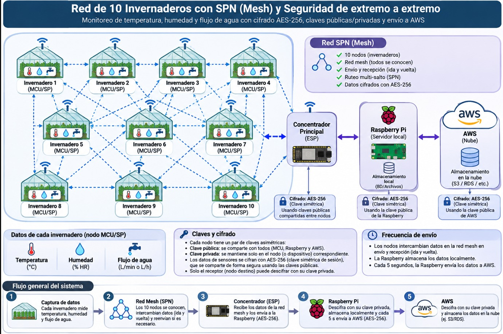

# Invernadero IoT · monitoreo y riego automático de invernaderos

Implementación funcional del informe **«Diseño de una solución IoT para el monitoreo y riego automático de invernaderos»**
(INACAP · Seguridad IoT · alternativa 2, bajo costo). Incluye el **firmware de la malla ESP-NOW** (un solo `.ino` para todas las placas),
el **concentrador** USB, la **pasarela** (Raspberry Pi, o el PC mientras tanto), una **base de datos** (PostgreSQL local, con envío cifrado a la nube cada 5 s) y un **dashboard web en
TypeScript** con control de acceso por rol.

## Capturas

| Predio (claro) | Predio (oscuro) |
|---|---|
|  |  |

| Detalle de un invernadero | Móvil |
|---|---|
|  |  |

<sub>Capturas de referencia tomadas durante el desarrollo, con datos **simulados**; la interfaz puede diferir en detalles menores.</sub>

## Estado actual (11 de noviembre de 2026)

**Objetivo (el diagrama del proyecto, [`docs/diagrama-objetivo.jpeg`](docs/diagrama-objetivo.jpeg)):** una red de hasta 10 invernaderos en malla (mesh) con cifrado de extremo a extremo.
Cada invernadero mide **temperatura, humedad y flujo de agua**. Un **concentrador** (un ESP por USB) une la malla con la **Raspberry Pi**, que guarda todo en local y **cada 5 s** lo envía a **AWS**.



```
Invernadero 1..10 (NodeMCU, mismo .ino)        Concentrador (ESP)        Raspberry Pi (o el PC que la simula)               Nube
 mide y cifra ──ESP-NOW──► vecinos reenvían ──►  oye la malla  ──USB──►  puente ► pasarela ► PostgreSQL ► dashboard ──5 s──► AWS
        ▲   (TTL 3, sin WiFi, canal fijo)         @RX / @TX                       │  (descifra con su clave privada)        (cifrado
        └────────────── respuesta cifrada (vuelve por radio hasta el origen) ◄────┘                                         con su clave pública)
```

### Cómo encaja cada parte del diagrama
| Diagrama | En el proyecto |
|---|---|
| 10 nodos en malla, «todos se conocen», ida y vuelta, multi-salto | Un solo `.ino` (`PERFIL 0`): radio ESP-NOW en un canal fijo, **sin WiFi**. Reenvío por inundación con TTL 3. Cada nodo emite una **baliza** cada 30 s y arma su tabla de nodos conocidos (`vecinos` en el JSON). |
| Temperatura, humedad y **flujo de agua (L/min)** | `armarJson` envía `temp`, `hum_aire`, `suelo_raw` y `flujo_lmin` (sensor de pulsos YF-S201 con `USAR_SENSOR_FLUJO 1`; simulado por defecto). Columna `flow_lmin` (migración `0010`) y tarjeta «Flujo de agua» en el dashboard. |
| **Concentrador Principal (ESP)** ↔ Raspberry Pi | `PERFIL 1` del mismo `.ino`: entrega cada mensaje a la Pi por USB (`@RX`) y devuelve la respuesta por la malla (`@TX`). En la Pi/PC corre el **puente serie** (`npm run puente`, `dashboard/scripts/puente-serie.ts`), que sube a la pasarela con `POST /relay/<id>`. |
| Raspberry Pi: servidor local, BD local | PostgreSQL + gateway + dashboard (`docker-compose.yml`). Funciona igual sin internet. |
| Pi → **AWS cada 5 s**, datos cifrados con la clave pública de AWS | Servicio `uplink` (`npm run uplink`): lotes JSON por HTTPS a `AWS_UPLINK_URL`, cifrados con **RSA-2048 + AES-256-GCM** con la clave pública de AWS (`AWS_PUBLIC_KEY_FILE`). El avance se guarda en `iot.uplink_state` (migración `0011`): si no hay internet no se pierde nada. `npm run aws:mock` simula la nube para probar. |
| Cifrado AES-256, solo el destino descifra | RSA-2048-OAEP envuelve una clave AES-256 de un solo uso; AES-256-GCM. Los nodos intermedios y el concentrador **no abren nada**. |

### Qué se hizo
- **Firmware único** `firmware/malla_espnow/malla_espnow.ino` con `PERFIL` 0 (nodo), 1 (concentrador) y 2 (nodo con WiFi, respaldo del modo anterior). Los tres compilan para NodeMCU (core 3.1.2).
- **Pasarela:** `POST /relay/<id>` (mismo pipeline que MQTT) con `X-Via` y `X-Saltos`; cada lectura guarda su ruta (`transport`, `via`, `hops`) — migración `0009`.
- **Ingesta tolerante:** acepta JSON con campos faltantes o extra (solo `seq` es obligatorio), entiende alias (`temperature`, `caudal`, `flow`…) y guarda lo desconocido en `extra`.
- **Modo abierto de pruebas** (`ACEPTAR_NODOS_NUEVOS=1`): sin tokens, cada identificador nuevo se da de alta solo y se coloca en un hueco libre del mapa (sin superposiciones).
- **Corre en la Raspberry Pi real** (`iot@iot.local`, carpeta `~/invernadero-iot`): PostgreSQL, Mosquitto, pasarela, dashboard (`http://<ip-de-la-pi>:3000`), `uplink` y `sync`, con las migraciones hasta la `0012`. El PC ya no hace de servidor (sigue sirviendo para pruebas: `scripts/firewall-pasarela-pc.ps1` abre y **cierra** los puertos 3100 y 3000). La Pi lleva la clave **privada** RSA (`secrets/`, fuera de git); el `.ino` lleva la **pública** (huella `89a778731578188e`).
- **Probado con placas reales (11-nov):** un concentrador (`PERFIL 1`, COM6) y dos nodos (`PERFIL 0`) → puente en el PC → pasarela de la Pi → PostgreSQL → dashboard. Las lecturas llegan con `transport=espnow`, `via` y `hops=1`.
- **Una placa que cambia de nombre no se duplica:** la pasarela liga cada id de chip (`nodo-xxxxxx`) a su nodo (`iot.open_devices`, migración `0012`) y, si llega un nombre nuevo desde un chip conocido, **renombra** su invernadero conservando historial, umbrales y lugar en el mapa. Detalle y excepciones en [`docs/malla-espnow.md`](docs/malla-espnow.md).
- **Pruebas automáticas:** 261 pruebas unitarias pasan (incluye puente, envío cifrado y flujo de agua) y 6 pruebas de base de datos nuevas (`tests/db/open-nodes.test.ts`, cambio de nombre sin duplicar). Comprobado de punta a punta: mensaje cifrado → puente → pasarela → respuesta que el nodo abre; lecturas con `flujo_lmin` → `uplink` → «AWS de prueba», que las descifra.

### Placas de prueba y MAC
| Placa | MAC | Nombre en el sistema | Notas |
|---|---|---|---|
| Placa 1 (COM6 en las pruebas) | `A4:CF:12:FE:F2:CC` | `nodo-fef2cc` | **Concentrador** (`PERFIL 1`) en las pruebas del 11-nov |
| Placa 2 | `FC:F5:C4:8D:57:2E` | `nodo-8d572e` | Tuvo fallos al conectar al WiFi al arrancar; no participó el 11-nov |
| Placa del compañero (práctica `espnow_cifrado`, en `material-clase/`) | `78:1C:3C:85:BB:C8` | `nodo-85bbc8` | Nodo (`PERFIL 0`); en el dashboard quedó como `GrupoSavka` |
| Placa de otra persona | (sin anotar) | `nodo-63c927` | Nodo (`PERFIL 0`); pasó por `grupo-1` y quedó como `Invernadero-DiazRamos` (código `I16`) |

La malla **no usa MAC**: difunde a todos. El identificador de cada placa sale de su chip (`nodo-<últimos 6 hex de la MAC>`) y es lo que la pasarela usa para reconocerla aunque cambie de nombre.

### Cómo probar con dos placas (el diagrama en pequeño)
1. **Servidor:** la Raspberry Pi ya lo tiene en marcha (`docker compose up -d` en `~/invernadero-iot`, con `ACEPTAR_NODOS_NUEVOS=1` en su `.env`). Para probar con el PC en su lugar: `docker compose --env-file .env --env-file .env.pc up -d --build postgres migrate gateway dashboard`.
2. Sube el `.ino` con `PERFIL 1` (concentrador) a **una** placa y con `PERFIL 0` (nodo) a las demás; cada nodo con su `NOMBRE_NODO` distinto. No hace falta WiFi ni `config_local.h`.
3. Conecta el concentrador por USB al PC y, en `dashboard/`, ejecuta `GATEWAY_URL=http://<ip-de-la-pi>:3100 npm run puente -- COM6` (el puerto de esa placa; en PowerShell: `$env:GATEWAY_URL=...`). **Cierra antes el Monitor Serie del Arduino IDE**: el puerto no se comparte (si no, el puente repite «Access denied»). Debe decir `Concentrador conectado`. Más adelante el concentrador pasa a la Pi: `CONCENTRADOR_DEV=/dev/ttyUSB0 docker compose --profile concentrador up -d puente`.
4. En ~10 s el nodo envía por radio; el puente muestra `<< nodo-… seq N (1 salto…) → pasarela` y `>> respuesta … (por la malla)`. En *Equipos* aparece «Vía nodo-… · 1 salto» y el flujo de agua en el invernadero.
5. Para la nube de prueba: `npm run aws:mock` (en otra terminal) y en `.env`: `AWS_UPLINK_URL=http://host.docker.internal:4010/ingest`, `AWS_PUBLIC_KEY_FILE=/run/secrets/aws-mock-public.pem`, luego `docker compose … up -d uplink`.

Guía completa y cómo revertirlo todo: [`docs/malla-espnow.md`](docs/malla-espnow.md) y [`PRUEBAS_TEMPORALES.md`](PRUEBAS_TEMPORALES.md).

### Qué falta (dicho sin adornos)
- **La respuesta de vuelta a las placas no está confirmada.** Las lecturas llegan a la Pi y la pasarela contesta, pero el 11-nov se vio a una placa repetir el mismo `seq` tres veces (la respuesta no le volvió en ese momento). No se diagnosticó si fue una pérdida de radio puntual o algo repetible: falta mirar el Monitor Serie del nodo (`<< respuesta recibida` o `sin respuesta… reintento`) con el concentrador conectado.
- **Salida serie corrupta:** antes, durante la transmisión por radio, el Monitor Serie se llenó de caracteres repetidos (parece cable/alimentación USB; sin confirmar). El puente descarta las líneas rotas, pero conviene un buen cable en el concentrador.
- **10 nodos y más de un salto:** solo se probaron 2 nodos con 1 salto. Con 10 habrá que vigilar la saturación de la radio (buffers de 64 mensajes vistos y 16 reenvíos, dispersión de 5–60 ms). El reenvío con varios saltos no se ha visto en placas reales.
- **Puente en el PC:** hoy el concentrador está en el PC, no en la Pi; si el PC se apaga o el puente se detiene, no llega nada. Además, si el puerto está ocupado, el puente escribe «No pude abrir COM6» cada 3 s (ruidoso, pero inofensivo).
- **Nube real:** `uplink` y el cifrado se probaron contra un AWS simulado. Falta la URL, la clave pública y el formato real de la API que entreguen (el mapeo de campos está en `scripts/lib/uplink-core.ts`).
- **Claves por nodo:** el diagrama habla de un par de claves por nodo y claves compartidas entre nodos. Aquí los nodos solo llevan la clave **pública** de la Pi (cifrado de extremo a extremo): cumple «solo el destino descifra» y los nodos intermedios no pueden leer, pero no hay claves propias por nodo.
- **Sensores reales:** temperatura, humedad y suelo son **simulados**; el flujo se lee de un sensor real solo con `USAR_SENSOR_FLUJO 1` (sin probar en placa).
- **Raspberry Pi:** ya está desplegada y funcionando (ver «Qué se hizo»). Falta pasar el concentrador a la Pi (servicio `puente`) y, antes de producción, usar el modo normal con tokens (`ACEPTAR_NODOS_NUEVOS=0`).
- **Migraciones `0010` y `0011`:** aplicadas en la base local de la Pi y del PC. Si se usa el `sync` a Supabase, hay que aplicar `0009` y `0010` allí (necesita credenciales de administrador) o `readings` se omite. La `0012` no se sincroniza.
- **Pruebas de base de datos** (`tests/db`): las nuevas (`open-nodes.test.ts`) pasan contra PostgreSQL local. El resto de la suite no se pudo dar por buena: `.env.local` apunta a Supabase y la base local del PC no tiene los datos de ejemplo (`npm run db:seed`), así que 16 pruebas fallan por el entorno, no por el código.
- **Seguridad antes de producción:** `POST /relay` no pide autenticación HTTP y el modo abierto acepta cualquier identificador y cualquier chip puede renombrar su invernadero (ver `PRUEBAS_TEMPORALES.md`).
- **⚠ Credenciales en el historial de git:** `dashboard/.env.local` y `dashboard/.env.admin.local` están versionados (commit `3bc8ed9`, «credenciales versionadas») con la contraseña de la base de Supabase, la de administrador y `APP_SECRET`, y el repositorio de GitHub es **público**. Hay que rotar esas contraseñas y el `APP_SECRET`, y dejar de versionar esos archivos (el historial no se borra solo).
- **Datos de prueba:** la base local del PC conserva invernaderos de pruebas (`GRUPO-A`, `GRUPO-B`, `I-FLUJO`, `I-PUENTE`). En la Pi, `I1`–`I10` (datos de clase; `I1` con 2711 lecturas) y los invernaderos duplicados de las pruebas con placas están **archivados**, no borrados; se restauran desde el dashboard.
- **Reporte de los nodos:** las placas de prueba envían cada 10 s, pero el dashboard espera 300 s por defecto, así que «Tramas 24 h» muestra porcentajes engañosos.

## Qué incluye

| Carpeta | Qué es |
|---|---|
| `firmware/malla_espnow/` | **El firmware de TODAS las placas (NodeMCU/ESP8266), un solo `.ino`**: cifra cada medición (RSA-2048 + AES-GCM), la sube por WiFi a la pasarela o, si no hay red, la difunde por **ESP-NOW** para que la suba un vecino (malla con hasta 3 saltos). Guía: [`docs/malla-espnow.md`](docs/malla-espnow.md). Los sensores del sketch son simulados (`armarJson`). |
| `docker-compose.yml`, `docker/` | **La Raspberry Pi** (o el PC) como sistema completo en la red local: Mosquitto + pasarela + PostgreSQL + dashboard + API y copia a Supabase. Guía: [`docs/gateway-raspberry.md`](docs/gateway-raspberry.md). |
| `dashboard/` | Aplicación web **Next.js 16 + React 19 + TypeScript estricto**: API de recepción de los nodos, paneles por rol, gráficos, alertas, órdenes de riego, bitácora. |
| `supabase/migrations/` | Esquema SQL (PostgreSQL 17): tablas, permisos mínimos, bitácora inmutable. |
| `docs/` | [`gateway-raspberry.md`](docs/gateway-raspberry.md) (la Pi), [`api-v1.md`](docs/api-v1.md) (API REST del dashboard), [`contrato-api.md`](docs/contrato-api.md) (protocolo nodo ↔ servidor), [`malla-espnow.md`](docs/malla-espnow.md) (la malla), [`seguridad.md`](docs/seguridad.md) (controles del informe → código). |
| `scripts/` | `firewall-pasarela-pc.ps1` (abre/**cierra** los puertos 3100 y 3000 para probar con el PC), `deploy-pi.ps1`, `demo-pc.ps1`. |

**¿Por qué TypeScript?** Es el lenguaje con mejor relación entre productividad, seguridad de tipos y ecosistema para un panel web:
los mismos tipos viajan del acceso a datos a la interfaz, y el compilador (modo `strict`) detecta errores antes de ejecutar. El
firmware queda en C++ (Arduino) porque el ESP32 lo exige.

## Arquitectura

La **Raspberry Pi 5** es el sistema completo y **funciona sin internet** (todo en la red local); cada 5 minutos copia los datos a Supabase.

```
 NodeMCU (ESP8266) ×N                Raspberry Pi 5 (docker compose)                                              Nube
 DHT22 · YL-38 · relé → bomba   MQTT   ┌───────────────────────────────────────────────────────┐
 riega solo aunque no haya red ──────▶ │ mosquitto ─▶ gateway ─▶ PostgreSQL local ◀─ dashboard │ ◀── navegador / apps (misma red)
                               ◀────── │  (broker)    (Node)      (rol iot_app)       :3000     │      http://IP_DE_LA_PI:3000
                              cfg + órdenes                            │            + API /api/v1│      API REST con clave Bearer
                                       │                               └── sync cada 5 min ──────┼──HTTPS──▶ Supabase (copia, 1 sentido)
                                       └───────────────────────────────────────────────────────┘
```

Las cuatro capas del informe se conservan: **percepción y acción** (nodos), **red** (MQTT en la red local en lugar de LoRaWAN, ver más abajo),
**procesamiento** (pasarela + reglas + alertas + base local) y **aplicación** (dashboard y API en la Pi). El riego **no depende de la Pi**: cada nodo decide
con su propia lectura y aplica límites duros (corte a 30 s, espera de 5 min, bloqueo por temperatura); el servidor solo ajusta umbrales y envía órdenes manuales.
Detalle, instalación y qué pasa cuando algo falla: [`docs/gateway-raspberry.md`](docs/gateway-raspberry.md) · API: [`docs/api-v1.md`](docs/api-v1.md).

> El dashboard también puede correr suelto en un PC contra Supabase (`npm run dev`, abajo): es el modo de desarrollo y de demostración con el simulador.

## Puesta en marcha

Requisitos: **Node.js ≥ 22.12** y el archivo `env.txt` de Supabase (ya está junto a esta carpeta).

```bash
npm install          # instala las dependencias de dashboard/
npm run setup        # crea .env.local, migra la base y siembra el predio de ejemplo (10 invernaderos), usuarios demo y nodos (sin datos simulados)
npm run dev          # http://localhost:3000   (también sirve `npm start`)
```

Estos comandos se pueden ejecutar **desde esta carpeta o desde `dashboard/`**: los de la raíz delegan en `dashboard/` (`npm start` en la raíz
levanta el servidor de desarrollo; la versión de producción es `npm run build` y luego `npm run start:prod`).

* **Cuentas demo** (una por rol, con contraseña aleatoria): `dashboard/.demo-credentials.md`.
* **Datos en vivo sin hardware**: en otra terminal, `npm run demo` (simula los nodos sembrados y el mástil, con un guion de alertas).
  Variantes: `npm run simulate -- --speed 120`, `--scenario heat|fault|offline|wind|dry|irrigate`, `--only I1,I3`, y
  `--add I11=<token>` para simular un invernadero creado desde el panel.
  `npm run demo` usa `--fast`: fija «Reporte del nodo» en 15 s para ver alertas en minutos y lo **restaura a 300 s al salir con Ctrl+C**
  (si cierras la terminal a la fuerza, vuelve a dejarlo en 300 s desde el panel de umbrales de cada invernadero).
* **Con placas reales (Arduino IDE)**: levanta la pasarela en el PC (`docker compose --env-file .env --env-file .env.pc up -d postgres migrate gateway dashboard`),
  abre `firmware/malla_espnow/malla_espnow.ino`, completa `WIFI_SSID`, `WIFI_PASS` y `GATEWAY_HOST` (IP del PC) y sube **el mismo archivo a todas las placas**.
  Paso a paso, pruebas y cómo revertirlo todo: [`docs/malla-espnow.md`](docs/malla-espnow.md).

Hasta que un nodo reporte por primera vez, el panel muestra «Sin datos»; si un nodo deja de reportar, pasa a «Sin conexión» a los 15 min.
**El simulador escribe en la MISMA base que los nodos reales**: no lo uses junto con ESP32 reales. Si lo usaste, limpia con
`npm run db:reset-data -- --yes` (borra telemetría, riegos, órdenes y alertas; conserva usuarios, invernaderos, umbrales y nodos con sus tokens).

## Roles y permisos

Implementados en `dashboard/src/lib/rbac.ts` (matriz de la tabla 11 del informe) y verificados en cada página, acción y consulta.

| Rol | Puede |
|---|---|
| Dueño | Ver el predio, alertas e historial de **todos** los sectores; exportar CSV. Solo lectura. |
| Administrador | Todo: usuarios, **invernaderos (alta, edición y baja)**, ajustes del predio, tokens de nodos, umbrales, riego, bitácora. |
| Ingeniero agrónomo | Analizar historial, ajustar umbrales, programar calendarios de riego, reconocer alertas. |
| Operador de campo | Ver alertas y **accionar el riego solo en sus sectores asignados** (confirmación en 2 pasos). |
| Técnico | Solo lectura: calidad de enlace (RSSI/SNR), estado de equipos y bitácora. Nunca acciona actuadores. |

## La cantidad de invernaderos no es fija

Los 10 del informe son solo el predio de ejemplo. El administrador maneja los invernaderos desde **Invernaderos** (menú lateral):

* **Nuevo invernadero**: nombre, cultivo, superficie, caudal de la bomba y posición en el mapa (clic en el mapa o el botón «Sugerir un lugar
  libre», que propone el sitio libre más cercano a la subestación). En una sola operación se crean el invernadero, sus umbrales (por defecto
  o copiados de otro) y su **nodo con su token**, que se muestra una vez. El código (`I11`, o el que elijas) es único y no cambia.
* **Editar** los datos y la posición, **Ajustes del predio** (tamaño del mapa, subestación, estanque) para que el predio crezca con los invernaderos.
* **Dar de baja / Reactivar**: nada se borra. Un invernadero dado de baja conserva todo su historial, sale del panel y su nodo queda
  deshabilitado (el servidor rechaza sus tramas). El nodo físico sigue regando de forma autónoma hasta que se apague.
* Un invernadero nuevo no lo ve ningún operador hasta que se le asigne en **Usuarios**. No hay un máximo práctico (hasta 32.767).
* Todo queda en la bitácora (`greenhouse.create`, `.update`, `.archive`, `.restore` y `site.update`).

La migración es `supabase/migrations/0003_scalable_greenhouses.sql` (se aplica con `npm run db:migrate`).

## Cómo está integrado Supabase

* **La conexión directa del `env.txt` (`db.<ref>.supabase.co`) solo tiene IPv6**, y muchas redes (incluida la de esta máquina) no
  la alcanzan. Por eso `npm run setup` descubre el *pooler* IPv4 del proyecto (`aws-0-us-west-2.pooler.supabase.com:5432`) y
  conecta por ahí, con **TLS verificado** contra la CA de Supabase (incrustada en `src/lib/db/supabase-ca.ts`).
* **La aplicación no usa el rol `postgres`.** Usa `iot_app`, con permisos mínimos: sobre la bitácora solo puede `INSERT`/`SELECT`.
  La clave de `postgres` vive en `dashboard/.env.admin.local` y solo la leen los scripts de migración y semilla.
* **Todo está en el esquema privado `iot`**, que la API pública de Supabase no expone, con RLS activado y sin permisos para
  `anon`/`authenticated`. Para verlo en Supabase: *Table Editor → esquema `iot`*.
* La base **nunca se consulta desde el navegador**; solo el servidor (Server Components, acciones y la ruta `/api/ingest`).

## Seguridad (resumen)

Contraseñas con scrypt · bloqueo tras 5 fallos · sesiones en base con expiración por rol (administrador 30 min) · TOTP opcional y
exigible por rol (`MFA_REQUIRED_ROLES`) · cookies `HttpOnly` + `SameSite=Lax` · CSP con nonce · un token por nodo (solo se guarda su
SHA-256) con anti-repetición · validación de rangos · órdenes de riego con doble confirmación · **bitácora inmutable con hash
encadenado y verificación desde la interfaz**. El detalle, control por control del informe, está en [`docs/seguridad.md`](docs/seguridad.md).

## Pruebas

```bash
cd dashboard
npm run typecheck   # TypeScript estricto
npm test            # 190 pruebas unitarias (controlador de riego, alertas, TOTP, scrypt, RBAC, pasarela MQTT/HTTP, claves de API…)
npm run test:db     # 103 pruebas de integración contra PostgreSQL (cada una se revierte): esquema, permisos, ingesta, órdenes, bitácora,
                    # claves de API y la sincronización con Supabase (segunda base temporal). Funcionan en cualquier PostgreSQL 17, no solo Supabase:
                    #   docker compose up -d postgres  (con el puerto publicado en 127.0.0.1) y las variables DATABASE_* / DATABASE_ADMIN_*
npm run e2e -- --url http://127.0.0.1:3000 --users cuentas.json   # interfaz web en Edge/Chrome: cada rol, riego en 2 pasos, CSV, bitácora (63 comprobaciones)
```
Resultados completos de la última ronda (incluye caídas de servicios, seguridad, arm64 y prueba con 10 nodos a la vez): [`docs/pruebas.md`](docs/pruebas.md).

## Decisiones y hallazgos sobre el informe

1. **Transporte**: el informe usa LoRaWAN → ChirpStack → MQTT → ThingsBoard. Aquí el último tramo es **HTTP(S) → API del dashboard →
   Supabase**, porque es lo que se puede probar con una placa y WiFi. El *payload* no cambia si se vuelve a LoRaWAN.
2. **Escala del YL-38**: se usa la de la imagen de la clase (**0–1023**: 0–300 saturado, 300–700 óptimo, 700–1023 seco). El ESP32
   mide en 12 bits (0–4095) y el firmware lo lleva a 10 bits. Riega con lectura ≥ 700 y se detiene en ≤ 500.
3. **Mini bomba** de la imagen (2,5–6 V, 80–120 L/h) en lugar de la bomba de 1/2 HP del informe, siempre con fuente propia y relé.
4. **Regla de «activaciones anómalas»** (tabla 10): con corte a 30 s y una sonda con retardo, casi todos los riegos terminan por
   tiempo máximo, así que «3 cortes seguidos» habría alertado siempre. La señal correcta es *tres riegos automáticos seguidos con
   menos de 15 min entre sí* (el suelo vuelve a secarse enseguida).
5. **Pines en placa Heltec V2**: el informe declara «probado en Heltec WiFi LoRa 32 V2», pero cinco de sus pines (GPIO 26, 4, 34, 25 y 21)
   chocan con el radio LoRa, la pantalla, el LED y `Vext` de esa placa; el firmware trae un mapa alternativo. Evidencia, tomada del
   archivo de pines del core de Espressif, en [`docs/hardware.md`](docs/hardware.md).
6. **Fuera de alcance del código** (son infraestructura): VLAN/cortafuegos MikroTik, VPN WireGuard, certificados de cliente X.509,
   elemento seguro ATECC608A y respaldo diario cifrado. Ver la sección correspondiente de `docs/seguridad.md`.

## Antes de producción

* Sirve el dashboard **detrás de HTTPS** y define `FORCE_HTTPS=true` (cookies `Secure`, HSTS). El firmware debe usar `https://`.
* Despliega **cerca de la base** (Oregón, `us-west-2`): cada consulta a Supabase cuesta ~200 ms desde Chile; una trama tarda ~1,2 s
  en régimen estable y hasta ~5 s tras un período inactivo. En serverless usa el pooler en modo transacción (`DATABASE_PORT=6543`).
* Activa el 2FA obligatorio: `MFA_REQUIRED_ROLES=admin,owner`.
* **Rota la contraseña de `postgres`** (está en `env.txt` y en `dashboard/.env.admin.local`) y borra el `env.txt` cuando termines.
  Cambia o desactiva las cuentas demo (`Usuarios → Desactivar`).
* Este repositorio incluye archivos con credenciales (`env.txt`, `dashboard/.env.local`, `dashboard/.env.admin.local`, `dashboard/.demo-*`):
  **mantenlo PRIVADO** y no lo publiques ni lo compartas fuera del equipo.
* Programa `npm run db:retention` (90 días de datos crudos, luego promedios horarios) o `pg_cron`.

## Limitaciones conocidas

* El límite de intentos de inicio de sesión por IP es por instancia (en memoria); el bloqueo por cuenta sí es global.
* Por defecto **no hay datos simulados**. Para una demostración: `npm run db:seed -- --history 48` (historial sintético) y `npm run demo` (datos en vivo).
* Una sola réplica del servidor en el diseño actual; el barrido de «nodo fuera de línea» corre al recibir tramas y al abrir el panel.
